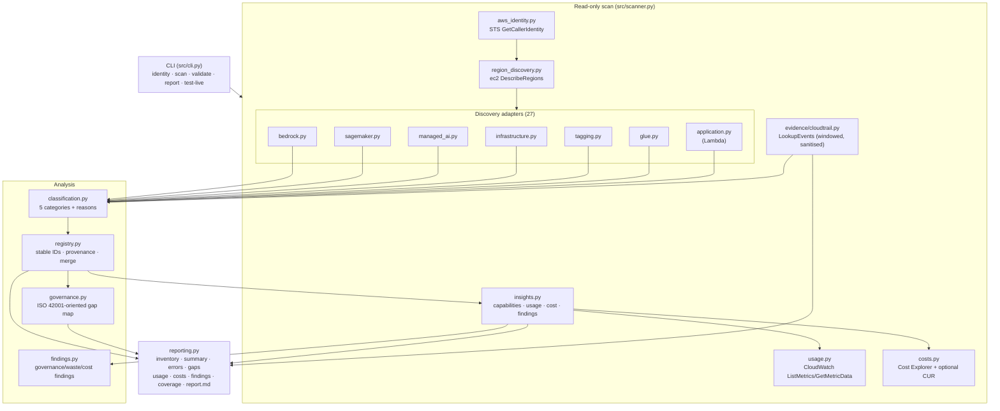

# Architecture

This document describes how the **AWS AI Discovery Agent** works: its data flow,
module boundaries, classification model, safety properties, and the deliberate
limits of what a read-only scan can prove.

## Purpose

Produce a defensible, machine-readable inventory of AI-related resources and
*activity* in an AWS account, suitable as an input to AI governance work
(including ISO/IEC 42001-oriented documentation). The tool never asserts
compliance and never claims usage it cannot evidence.

## High-level data flow



## Module responsibilities

| Module | Responsibility |
|---|---|
| `src/cli.py` | Argument parsing, command dispatch, console summary. Only entry point. |
| `src/config.py` | `ScanConfig` (regions, window, retries, report dir, scan id), `STALE_AFTER_DAYS`, `utcnow()`. |
| `src/errors.py` | `OperationError`, `classify_exception` (access_denied / unsupported / throttling / other), retry helper `with_retry`, JSON logger. |
| `src/aws_identity.py` | STS `GetCallerIdentity`; fails fast, never logs credentials. |
| `src/region_discovery.py` | Enumerates enabled Regions via `ec2:DescribeRegions`. |
| `src/discovery/base.py` | `BaseAdapter`, `DiscoveredResource`, `AdapterResult`, `register_adapter` registry. |
| `src/discovery/paginate.py` | `collect_pages` (paginated list) and `call_single` (unpaginated) helpers. |
| `src/discovery/bedrock.py` | Bedrock + bedrock-agent listings; separates catalogue from account resources. |
| `src/discovery/sagemaker.py` | SageMaker models/endpoints/configs/jobs/pipelines/packages/components/experiments. |
| `src/discovery/tagging.py` | Resource Groups Tagging API discovery for `AI-System`-tagged non-AI-native resources. |
| `src/discovery/managed_ai.py` | Rekognition, Textract, Comprehend, Lex V2, Polly, Transcribe, Translate, Personalize, Kendra, Q Business, Fraud Detector, Forecast, Lookout for Equipment, HealthImaging listings. |
| `src/discovery/infrastructure.py` | Evidence-based EC2/ECS/EKS/S3/OpenSearch/Redshift/Aurora/Neptune association discovery. |
| `src/discovery/glue.py` | Glue ML transforms (`ListMLTransforms` + bounded `GetMLTransform`). |
| `src/discovery/application.py` | Lambda functions with static AI-association indicators. |
| `src/capabilities.py` | 55-service capability registry: discovery, usage, billing scope, limitations, runtime status. |
| `src/usage.py` | Bounded CloudWatch `ListMetrics`/`GetMetricData`; resource-dimension matching; honest `no_datapoints`/`partial`. |
| `src/costs.py` | Daily Cost Explorer service/Region cost, optional CUR CSV/GZIP, no unsupported allocation. |
| `src/findings.py` | Governance, telemetry, attribution, idle-runtime, low-utilization, and cost-change findings. |
| `src/insights.py` | Orchestrates capability status, usage, cost, attachment, and findings after discovery. |
| `src/evidence/cloudtrail.py` | Windowed `LookupEvents`, dedupe, metadata-only sanitisation, invocation vs management split. |
| `src/classification.py` | The 5-category model, event↔record matching, staleness policy. |
| `src/registry.py` | `RegistryRecord`, stable record IDs, provenance, merge semantics, missing-field computation. |
| `src/governance.py` | Maps registry fields to ISO/IEC 42001-oriented documented-information expectations and reports gaps. |
| `src/reporting.py` | Writes all artifacts, CSV/JSON serialisation, schema validation, Markdown report. |
| `src/live_tests.py` | Live test cases (`test-live`), with explicit skip gates for cost/mutation. |

## Adapter contract

Every adapter implements:

```python
class BaseAdapter:
    name: str                      # registry key, e.g. "bedrock"
    def api_operations(self) -> list[tuple[str, str]]     # (client, Operation)
    def required_permissions(self) -> list[str]           # IAM actions
    def documented_blind_spots(self) -> list[str]         # honest limits
    def discover(self, session, region) -> AdapterResult   # read-only
```

`AdapterResult` carries `resources`, `errors` (`OperationError`), and
`operations_attempted` / `operations_succeeded`. A denied or unsupported
operation is recorded as an error and the scan **continues** — a partial result
is always preferable to a crash, and "denied" is never reported as "absent".

## Discovery catalogue vs account resources

A crucial distinction runs through the whole system:

* **Catalogue entries** (`resource_kind="catalog"`) describe what is *available*
  in a Region — e.g. Amazon Bedrock foundation models and **AWS-managed
  (system-defined) inference profiles**. They are recorded for context but are
  never treated as organizational AI resources.
* **Account resources** (`resource_kind="account_resource"`) are concrete
  resources in the account (SageMaker endpoints, Bedrock agents/guardrails/
  knowledge bases, application-created inference profiles, Glue ML transforms,
  …). These are candidates for the organizational AI inventory.

System-defined inference profiles are detected by `type == SYSTEM_DEFINED` or by
the AWS-managed id prefixes (`apac.`, `global.`, `us.`, `eu.`, `in.`, …). This
prevents a global routing artifact from being misreported as a stale
account resource.

## Classification model

Records are classified into one of five categories (strongest first):

| Category | Meaning | Typical evidence |
|---|---|---|
| `CONFIRMED_AI_ACTIVITY` | Direct, attributable evidence of an AI API call | CloudTrail invocation events (successful or mixed) |
| `CONFIGURED_AI_RESOURCE` | Concrete AI resource exists; no activity evidence | AWS list APIs |
| `POTENTIAL_AI_USAGE` | Association/tag/static config suggests AI use | `AI-System` tag; Lambda env var name/key indicators |
| `INACTIVE_OR_STALE` | Configured resource with no activity and old modification time | list APIs + staleness policy (>90 days) |
| `UNKNOWN` | Catalogue availability, or no AI-specific evidence | list APIs / none |

Usage status is more granular: `confirmed`, `configured_but_unverified`,
`potential`, `inactive`, `unknown`.

## Usage, cost, coverage, and findings

After discovery, `insights.enrich_scan` runs without mutating AWS:

1. Build the 55-service capability registry and mark each adapter outcome
   (`supported`, `partial`, `not_configured`, `permission_denied`, `unsupported`,
   `collection_failed`).
2. Query CloudWatch per scanned Region with bounded namespaces/metrics/datapoints.
   Resource-scoped measurements require a matching dimension; everything else is
   service-scoped. No datapoints is not zero usage.
3. Query Cost Explorer daily `UnblendedCost` grouped by `SERVICE` and `REGION`
   for AI-capable services. Optional CUR rows are merged when configured. Cost is
   never allocated without a billing identifier.
4. Finalize capability counts/status and attach measurements/costs to records.
5. Generate advisory findings with evidence references and limitations.
6. Preserve inventory results even if enrichment fails; the failure is recorded.

Capability statuses are runtime facts, not marketing claims: a service can be
discoverable but have unavailable telemetry, or billable but not opted in.

### Evidence hierarchy (what justifies what)

```
CloudTrail invocation ──► CONFIRMED_AI_ACTIVITY (usage: confirmed / configured_but_unverified if only failures)
Account resource listed ─► CONFIGURED_AI_RESOURCE (usage: configured_but_unverified)
Tag / static config ─────► POTENTIAL_AI_USAGE (usage: potential)
Stale account resource ──► INACTIVE_OR_STALE (usage: inactive)
Catalogue / nothing ─────► UNKNOWN (usage: unknown)
```

Absence of CloudTrail events is **never** treated as proof of non-use:
invocation data events must be operator-enabled and are only retained for 90
days. Every non-confirmed record carries `evidence_limitations` stating this.

## Stable record identity

```python
record_id = "air-" + sha256(f"{account}|{region}|{service}|{type}|{id}")[:16]
```

Stable across scans so that governance metadata (owner, purpose, risk notes)
attached to a record survives later scans. `merge_with_previous` unions
historical observations and evidence while letting the **fresh classification
win** (classification is derived from current evidence and current code), except
that a previously *evidenced* activity record is never demoted by a fresh
listing that simply didn't observe it.

### Merge keeps every artifact describing the same registry

A merged scan's inventory can hold more records than the fresh scan discovered.
Every artifact is therefore derived from the **merged** record set, never from
the fresh scan alone:

| Artifact | Derived from |
|---|---|
| `inventory.json` → `records` | merged registry (previous ∪ fresh) |
| `inventory.json` → `scan.records_total`, `classification_counts`, `usage_status_counts` | merged record set (`refresh_scan_counts`) |
| `summary.json` | the same `scan` block |
| `governance_gaps.json` → `records_analyzed` | merged record set (`analyze_gaps`) |
| `report.md` | the same counters and gaps |

`resources_discovered` stays scan-scoped: it reports what *this* scan found, not
what the registry holds. A scan that discovers nothing but merges into an
existing inventory therefore reports `Resources discovered: 0` alongside
`Registry records: N` — the two numbers answer different questions on purpose.

## Safety properties

* **Read-only by default.** The only mutating-capable path is Bedrock model
  invocation, which is gated behind `--enable-model-invocation` and is never
  invoked automatically.
* **No secrets printed or stored.** CloudTrail events are reduced to metadata
  (event id, name, time, caller ARN, target identifier allowlist); prompt
  bodies, model outputs and request payloads are dropped. Lambda association
  records the *name* of a matching environment variable, never its value.
* **No resource creation or tag mutation.** Live tests B/C/E (create resource,
  create endpoint, mutate tag) are documented and skipped rather than automated.
* **Errors are first-class.** Access-denied / unsupported operations are
  recorded in `scan_errors.json` and reflected in coverage, never silently
  swallowed.

## Artifacts

A scan writes to `--report-dir` (default `reports/`, git-ignored):

| File | Contents |
|---|---|
| `inventory.json` | Full registry document (schema-validated). |
| `inventory.csv` | Flat view for spreadsheet triage. |
| `summary.json` | Scan metadata, counts, coverage. |
| `scan_errors.json` | Denied/unsupported/throttled operations. |
| `governance_gaps.json` | Per-record missing governance fields + follow-ups. |
| `usage_measurements.json/csv` | Bounded CloudWatch measurements with collection status. |
| `costs.json/csv` | Reported Cost Explorer/CUR records with attribution confidence. |
| `findings.json/csv` | Evidence-bound governance, telemetry, waste, and cost findings. |
| `coverage_report.json/csv` | Per-service discovery/usage/billing status and limitations. |
| `evidence/cloudtrail-events.json` | Sanitised activity evidence (metadata only). |
| `report.md` | Human-readable scan report. |
| `test_results.json` | Live test outcomes. |

## Testing strategy

Unit tests use synthetic boto3 clients under `tests/` only; they are not used
by the application, CLI, or reports. The application always reads from live AWS
APIs. Live verification is opt-in:

```bash
python -m src.cli --profile <profile> test-live --enable-live-tests
```
